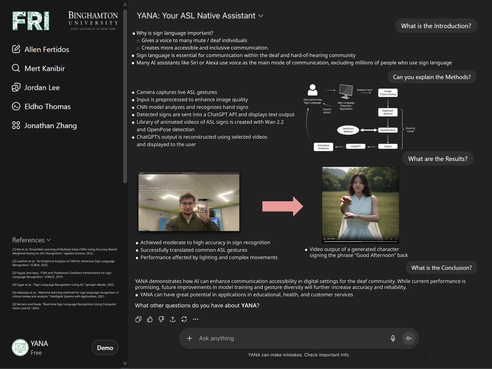

<h1 align="center">YANA</h1>

<p align="center"><strong>Your ASL Native Assistant</strong></p>

<p align="center">ASL fingerspelling research with hand-landmark classification and conversational text responses.</p>

<p align="center">
  <a href="https://www.python.org/"></a>
  <a href="https://opencv.org/"></a>
  <a href="https://ai.google.dev/edge/mediapipe"></a>
  <a href="https://www.tensorflow.org/"></a>
</p>

<p align="center">
  <a href="https://numpy.org/"></a>
  <a href="https://scikit-learn.org/"></a>
  <a href="https://huggingface.co/docs/transformers"></a>
  <a href="https://developers.openai.com/api/docs/libraries?language=python"></a>
</p>

<p align="center">Binghamton University · First-year Research Immersion</p>

**Public release preparation, 9 November 2026:** Cleaned the maintained repository history and local environment artifacts, cleared notebook outputs, and edited this README for public release. The missing runtime assets documented below still prevent a clean-clone launch.

## Semester 3 research poster

[](docs/media/yana-semester-3-poster.pdf)

<p align="center"><a href="docs/media/yana-semester-3-poster.pdf">View or download the full-resolution poster PDF</a></p>

The team’s Semester 3 poster documents a broader research workflow, including CNN recognition, Wan 2.2, OpenPose, and generated signing videos. This repository preserves an earlier landmark-classification and text-response prototype. The poster’s authorship and research claims are preserved in the original layout. Its results do not establish a benchmark for the code in this checkout. See [poster provenance](docs/media/README.md).

## Implemented scope

- OpenCV webcam capture with mirrored frames and a live recognition overlay.
- MediaPipe hand landmarks, converted to 42 normalized coordinates per hand.
- A TensorFlow/Keras training notebook for 26 alphabet classes, with TensorFlow Lite export.
- Manual letter capture, sentence assembly, keyboard input, and a conversation overlay.
- OpenAI Chat Completions for text replies, with recent conversation context.

The active response function calls `gpt-3.5-turbo`. Startup also loads GPT-2 through Transformers, although that local model is not used by the response function. Provider model access, dependency resolution, and startup model downloads require separate environment validation.

## Snapshot limitations

**A clean clone cannot currently launch the camera application.** The application references runtime assets that are absent from this snapshot:

- `model/keypoint_classifier/keypoint_classifier.py`
- `model/keypoint_classifier/keypoint_classifier_label.csv`
- A trained classifier artifact. The notebook exports `model/keypoint_classifier/keypoint_classifier.tflite` and a Keras model, but neither is checked in.

The landmark CSV and training notebook are included. Restoring the classifier wrapper and label mapping requires the original project assets. Training a new model alone does not restore those missing files.

Alphabet-gesture classification is the implemented recognition scope. The Semester 3 poster’s CNN pipeline, OpenPose processing, Wan video generation, and signing-video assembly are not included in this code snapshot. Lighting, hand visibility, and motion can affect recognition. No end-to-end accuracy or accessibility validation is claimed here.

## Environment preparation

Use a fresh Python environment compatible with the pinned TensorFlow 2.16.1 dependency. The repository does not provide a tested dependency lock. Bundled machine-specific environment files were removed during release preparation. Local virtual environments are ignored.

After restoring the missing runtime assets:

```bash
git clone https://github.com/mertkanibir/your-asl-native-assistant.git
cd your-asl-native-assistant
python3 -m venv .venv
source .venv/bin/activate
python -m pip install -r requirements.txt
export OPENAI_API_KEY="your_own_key"
python app.py
```

The client reads `OPENAI_API_KEY` from the shell environment. An unset or blank value stops startup with a configuration message. `.env` files do not load automatically. Use your own credential and keep it out of source control. See the [official OpenAI Python SDK instructions](https://developers.openai.com/api/docs/libraries?language=python).

## Controls

| Key | Behavior |
| --- | --- |
| `r` | Arm capture of the next detected letter |
| Space | Append a space |
| `c` | Clear the current sentence |
| `s` | Send the assembled text for an AI reply |
| `t` | Enter a message through the terminal |
| `n` | Select inference mode |
| `k` | Select webcam landmark logging mode |
| `A`–`Z` | Select a class for landmark logging |
| `d` | Process a separately supplied image dataset |
| Escape | Exit the camera application |

## Training and repository layout

[`keypoint_classification.ipynb`](keypoint_classification.ipynb) reads the landmark CSV, splits training and test data, trains a dense classifier, and exports Keras and TensorFlow Lite artifacts. Its evaluation cells use scikit-learn, pandas, seaborn, and matplotlib. Outputs and execution counts were cleared for public release. Use a compatible local environment to reproduce training and evaluation.

| Path | Purpose |
| --- | --- |
| `app.py` | Webcam loop, landmark preprocessing, controls, and text-response integration |
| `model/keypoint_classifier/keypoint.csv` | Collected hand-landmark training rows |
| `keypoint_classification.ipynb` | Classifier training and evaluation notebook |
| `utils/cvfpscalc.py` | Rolling frame-rate calculation |
| `docs/media/` | Semester 3 poster PDF, preview, and provenance |

## Focused configuration checks

```bash
python3 -m unittest discover -s tests -v
```

These offline tests exercise credential configuration and the response function with a fake SDK client. They do not import the camera application, contact OpenAI, download models, or establish that the missing runtime assets have been restored.

## Contributors and attribution

- Allen Fertidos
- Mert Kanibir
- Jordan Lee
- Eldho Thomas
- Jonathan Zhang

Developed through Binghamton University’s FRI research program. The original ASL recognition framework credits Akram ADRANE, Othmane DAOUDI, and Yassir HAKKOU.

Both MIT notices are retained: [project license](LICENSE), copyright 2025 Mert Kanibir, and [upstream license](LICENSE.md), copyright 2024 Akram ADRANE, Othmane DAOUDI, and Yassir HAKKOU. Preserve both notices when redistributing their covered code. Poster authorship remains visible in the supplied research material.
